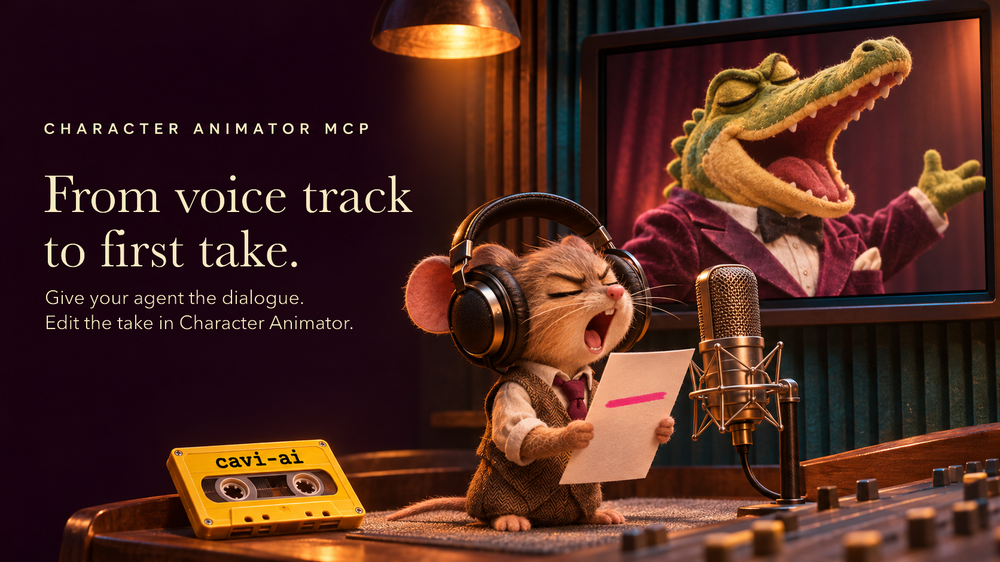
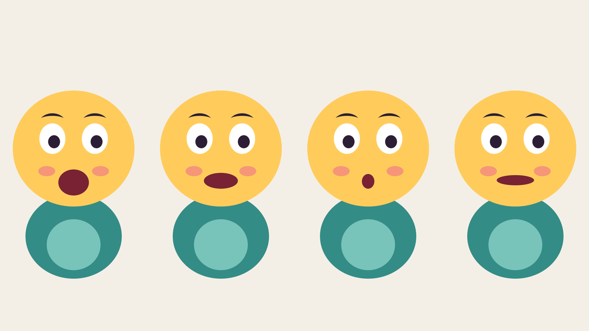

# Cavi Character Animator MCP

## Turn recorded dialogue into a take you can still edit.



[](LICENSE) [](https://pypi.org/project/cavi-character-animator-mcp/)

Your agent can prepare a project copy, import a puppet PSD or dialogue WAV, and run Adobe’s
lip sync on scene audio. Refine the take in Character Animator, then have the agent check the
exported PNG frames and WAV against your handoff recipe.

[Install](#install) · [Try your first take](#quickstart) · [Read the guides](#documentation)

## Install

Requires macOS, Adobe Character Animator installed and signed in, the Swift command-line compiler
(`xcode-select --install`; the server compiles its native helper on first use) and Python 3.15 or later with
[uv](https://docs.astral.sh/uv/). The MCP host needs Accessibility access; `capture` also needs Screen Recording
access. You supply your own licensed Adobe applications.

```sh
uv tool install cavi-character-animator-mcp
```

Upgrade with `uv tool upgrade cavi-character-animator-mcp`. To work from a checkout instead, see
[CONTRIBUTING.md](CONTRIBUTING.md).

## Quickstart

Register the stdio server with your MCP client and set the workspace:

```json
{
  "mcpServers": {
    "character-animator": {
      "command": "cavi-character-animator-mcp",
      "env": {"CAVI_ADOBE_WORKSPACE": "/absolute/path/to/workspace"}
    }
  }
}
```

If your client does not inherit your shell's `PATH`, use the absolute path that
`command -v cavi-character-animator-mcp` prints.

Start with a closed Character Animator project whose scene already contains a puppet and its
dialogue. Ask your agent for one take you can review.

> Prepare a copy of `projects/Hero` and open the copy. Select `Scene 1`, run Character
> Animator’s lip sync from the scene audio, and inspect the result.

The [first result guide](docs/character-animator-mcp/source/pages/guides/first-result.md) walks
through that take and its export. The [setup guide](docs/character-animator-mcp/source/pages/guides/setup.md)
covers macOS permissions and workspace paths.

## Try one take

This example imports a puppet PSD and a spoken line into a new project, records a lip-sync take from the
scene audio, and checks the exported PNG frames and WAV into a pinned handoff.



[Explore the example and source media](examples/first-take/README.md).

## What you can do

- **Keep the original handy.** Prepare a separate, editable copy of a closed project. The server
  checks the copied files and confirms which project the session owns before editing.
- **Work with your own puppet and dialogue.** Import a puppet PSD or a dialogue WAV and use
  Character Animator’s scene and lip-sync actions on the selected items.
- **Check the handoff.** Request a PNG sequence and WAV. Check frame order, file hashes, and
  audio timing against an explicit recipe, then save a receipt for the output files.
- **See where the work landed.** Inspect the open project, capture the app window, and review
  recorded operations before continuing an interrupted action.

| Tool | Purpose |
|---|---|
| `character_status` | Report whether the application is running and reachable. |
| `inspect` | Read the process, project root, native controls, visible Project panel rows, timeline selection and unresolved operation state. |
| `capture` | Capture the Character Animator window with text recognition into a new workspace directory and return it as an image. |
| `session_control` | Inspect, claim, renew, release or resume ownership of an open project. |
| `project_prepare_copy` | Copy a closed `.chproj` tree into the workspace and verify its file hashes. |
| `project_open_prepared_copy` | Open a prepared copy in the application. |
| `project_save_copy` | Save an owned project as a new copy. |
| `import_media` | Import a puppet PSD or a dialogue WAV and report the new Project panel row. |
| `scene_action` | Run one menu action on the selection: add to a new scene, create a take from scene audio, compute lip sync, set the work area to the selection or export PNG and WAV. |
| `scene_export` | Export a PNG Sequence and WAV of the owned scene into a new workspace directory and report the written files. |
| `project_select` | Select a puppet, audio or scene row in the Project panel by name. |
| `operation_control` | Inspect, verify or continue a recorded native operation. |
| `export_inspect` | Validate exported PNG and WAV files, their hashes and the dialogue sample timing. |
| `export_ingest` | Write a pinned media receipt and a measured audio descriptor for the exported files. |

See the [tool reference](docs/character-animator-mcp/source/pages/reference/tools.md) for parameters and results.

## Closed projects and recovery

For a closed Character Animator project, prepare a copy with `project_prepare_copy`, open that prepared copy, inspect
its project root and claim it with `session_control` before editing. An import is confirmed when its puppet or audio
row appears in the Project panel; an unknown import whose row appears later is resolved with `operation_control`
`reconcile_import`, with the application still running. After a process exits, the operation control and session
control tools provide explicit reconciliation and lease release actions; they preserve unknown outcomes and project
files. To record a cancelled import, the server asks you directly when your MCP client supports elicitation.

Keep workspace ownership records private. Each native operation is recorded before it runs. If an operation reports
an unknown outcome, inspect the application and outputs or reconcile the recorded operation before trying again. See
[project copies and ownership](docs/character-animator-mcp/source/pages/guides/project-copies.md) and
[recovery and unknown outcomes](docs/character-animator-mcp/source/pages/guides/recovery.md).

## Documentation

The documentation source is in `docs/character-animator-mcp/source`:

- [Overview](docs/character-animator-mcp/source/pages/introduction/overview.md) and
  [setup](docs/character-animator-mcp/source/pages/guides/setup.md)
- Guides: [your first result](docs/character-animator-mcp/source/pages/guides/first-result.md),
  [project copies and ownership](docs/character-animator-mcp/source/pages/guides/project-copies.md),
  [importing and exporting](docs/character-animator-mcp/source/pages/guides/importing-and-exporting.md),
  [recovery and unknown outcomes](docs/character-animator-mcp/source/pages/guides/recovery.md) and
  [troubleshooting](docs/character-animator-mcp/source/pages/guides/troubleshooting.md)
- Reference: [tools](docs/character-animator-mcp/source/pages/reference/tools.md),
  [results and errors](docs/character-animator-mcp/source/pages/reference/results-and-errors.md),
  [configuration](docs/character-animator-mcp/source/pages/reference/configuration.md) and
  [testing and evaluation](docs/character-animator-mcp/source/pages/reference/testing.md)
- [Security model](docs/character-animator-mcp/source/pages/security/model.md) and
  [version and support](docs/character-animator-mcp/source/pages/release/version-and-support.md)

## Configuration

| Variable | Meaning |
|---|---|
| `CAVI_ADOBE_WORKSPACE` | Absolute directory every tool path is relative to. Required. |
| `CAVI_ADOBE_DATA` | Private server state: native helper builds and Character Animator journals. Defaults to `~/.local/share/cavi-adobe-mcp`. |
| `CAVI_CHARACTER_ANIMATOR_APP` | The Character Animator `.app` to use. |

Without an override the server uses the newest installed version under `/Applications` with the application's bundle
identifier. An override that names another application is refused with `APP_IDENTITY_MISMATCH`.

## Security

The server speaks MCP over stdio, sends no telemetry and uses no accounts. It controls Character Animator with the
Accessibility and, for `capture`, Screen Recording permissions of the MCP host, so run it only for clients you
trust. Tool paths are confined to the workspace, and the tools that change the project refuse any project that is
not an owned copy. See the [security model](docs/character-animator-mcp/source/pages/security/model.md) and
[SECURITY.md](SECURITY.md).

## Contributing

See [CONTRIBUTING.md](CONTRIBUTING.md) for setup, checks and the rules for changes. This project follows
the [Code of Conduct](CODE_OF_CONDUCT.md).

## License

MIT. See [LICENSE](LICENSE).

## Trademarks

Adobe and Character Animator are either registered trademarks or trademarks of Adobe in the United States and/or
other countries. This project is not affiliated with, endorsed by, or sponsored by Adobe. It does not include or
redistribute Adobe software, puppets or project files; you supply your own licensed application.
