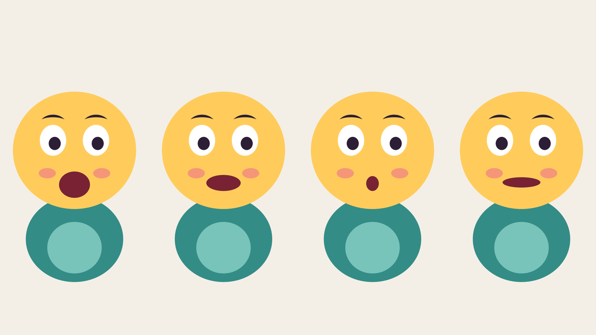

# First take

A layered puppet PSD and a spoken line, imported into a new Character Animator project, put in a scene and
lip-synced from the scene audio. Character Animator exported the take as a PNG sequence and a WAV, and the
server checked the export and wrote a pinned handoff. The strip shows exported frames 10, 30, 40 and 50, at
0.42, 1.25, 1.67 and 2.08 seconds into the line.



## The inputs

[media](media) holds the puppet and the line:

| File | What it is |
|---|---|
| `Pip.psd` | A 600 by 800 puppet: a `Pip` group with `Head`, `Belly` and `Body`, eyes, eyebrows and cheeks, and a `Mouth` group of 12 visemes (`Neutral`, `Ah`, `D`, `Ee`, `F`, `L`, `M`, `Oh`, `R`, `S`, `Uh`, `W-Oo`) |
| `dialogue.wav` | "Hi, I'm Pip. Watch my mouth move with every word I say." 3.2 s, mono, 24 kHz, 16-bit |

The puppet was drawn in Photoshop with the Adobe MCP Photoshop tools and the line was spoken by Chatterbox
text-to-speech. Both are part of this repository and covered by its [MIT license](../../LICENSE).

## Reproduce it

You need the server [installed](../../README.md#install), Character Animator signed in, and the
[macOS permissions](../../docs/character-animator-mcp/source/pages/guides/setup.md) granted. Make a new, empty
project in Character Animator, save it in a workspace folder and close it. From a checkout, run the example with
the workspace and the project folder inside it:

```sh
uv run --locked python examples/first-take/run.py ~/Desktop/take empty
```

[run.py](run.py) starts the server over stdio with `CAVI_ADOBE_WORKSPACE` set to the workspace, copies
[media](media) into `first-take/media` and calls:

1. `project_prepare_copy` and `project_open_prepared_copy` to open a copy of the empty project as
   `first-take/Pip`, then `session_control` `claim`;
2. `import_media` for `Pip.psd` as `puppet_psd` and `dialogue.wav` as `audio_wav`, waiting after each until the
   chooser is closed and File > Import is enabled again;
3. `project_select` for the puppet and the WAV, and `scene_action` `add_to_new_scene`;
4. `scene_action` `create_take_from_scene_audio` once the command is enabled;
5. `scene_export` to `first-take/export` once File > Export > PNG Sequence and WAV is enabled, then waits for
   the export's `Pip.json` and `Pip.xml`;
6. `export_inspect` and `export_ingest` on a recipe of every fifth frame of the first 80 at 24/5 fps, the WAV
   clipped to those 16 frames and the source files, then `session_control` `release`. A media receipt holds at
   most 32 million PNG pixels, and each exported frame is 1702 by 988.

Each `inspect` it waits on must pass twice in a row with the same fingerprint. To do the same from your agent,
ask it to make those calls in that order.

## What it returned

[results.json](results.json) holds the measured results: what the scene export wrote, the recipe run.py
declared, and the `export_ingest` answer. Paths in the file are relative to the workspace.

- The export wrote 720 frames, `Pip.000.png` to `Pip.719.png`, at 1702 by 988 for the 30-second scene, and
  a 30-second stereo 48 kHz 32-bit float WAV.
- The handoff holds 16 frames at 24/5 fps, 3.33 seconds, and the WAV clipped to its first 160000 samples, the
  same 3.33 seconds. `sample_format` is `float`.
- The handoff pins the project, the puppet, the source line, `Pip.xml` and the export's `Pip.json` by hash.
  `frame_rate_source` is `caller_declared`, and the XML timing is not interpreted.
